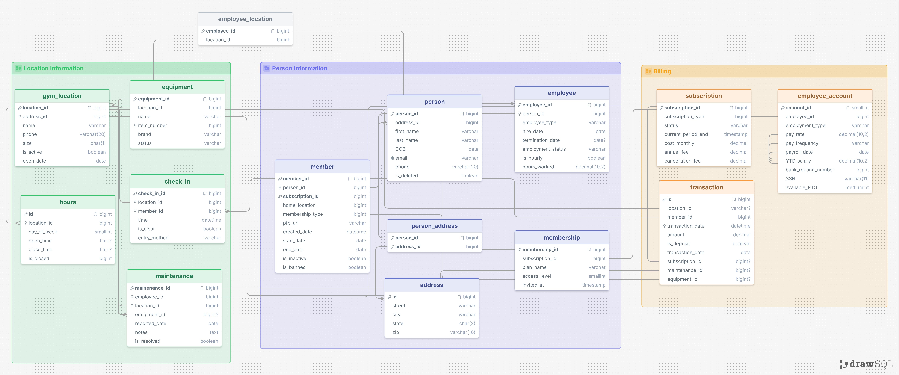

# Gym SQL Assistant — CS452

Ask questions about a fictional weightlifting gym in ordinary language. The app
generates SQL, queries a local SQLite database, and sends the actual results back
to OpenAI for a plain-language answer. It supports the three prompting settings
from the assigned paper and records real runs for comparison.

The database models members, people and households, membership plans, gym
locations, employees, equipment, check-ins, maintenance, hours, and recorded
payments. Its 15 tables are based on the original gym design in `gym_setup.sql`.
The included data comes from the supplied synthetic `gym_dummy_data.sql`: 400
people, 360 members, 10 gyms, and 60 employees. Contact, financial, and other data
are demonstration values. No real account credentials are included in the DB.



## Quick start

Your original `config.json` uses this structure. It is private and ignored by Git:

```json
{"openaiKey": "YOUR_OWN_OPENAI_API_KEY"}
```

API billing credits are required. A ChatGPT/Codex subscription is a separate
service from the API. Never include the actual key in reports, screenshots, or
commits. An `OPENAI_API_KEY` environment variable takes precedence over the file.

From this directory, with Python 3.10+:

```powershell
python -m pip install -r requirements.txt
python init_db.py
python db_bot.py
```

`gym.db` is included for sharing the SQLite database. If it already exists,
`init_db.py` preserves it. Use `--database another-gym.db` to create a separate
fresh demonstration database. The normal app never recreates or seeds a database.

On this computer, `run.ps1` also finds Codex's bundled Python and the local
`.deps` folder. No separate MySQL server is needed for the default app:

```powershell
powershell -NoProfile -ExecutionPolicy Bypass -File .\run.ps1
powershell -NoProfile -ExecutionPolicy Bypass -File .\run.ps1 -Question "How many members have Provo Training Center as their home gym? Include inactive and banned memberships."
powershell -NoProfile -ExecutionPolicy Bypass -File .\run.ps1 -Strategy single_domain
powershell -NoProfile -ExecutionPolicy Bypass -File .\run.ps1 -CheckDb
powershell -NoProfile -ExecutionPolicy Bypass -File .\run.ps1 -Test
```

Type `exit` to finish an interactive session. Each answer displays generated SQL
and an estimated API cost; the detailed record is saved in `runs/`.

## Run the assignment experiments

```powershell
python run_examples.py
# Or, on this computer:
powershell -NoProfile -ExecutionPolicy Bypass -File .\run.ps1 -Examples
```

This runs ten questions with all three strategies (up to 60 calls). It writes
`examples.md` and `examples.json` incrementally, retaining results if interrupted.
It stops after an API error instead of repeatedly retrying or claiming success.
For a short experiment:

```powershell
python run_examples.py --ids birthdays households --strategies zero_shot single_domain
```

The examples include Connor's ideas about birthdays, home gyms, membership
upgrades, and households, plus questions about staff, pay, equipment brands,
maintenance, check-ins, and plans. The upgraded-membership question cannot be
answered from this schema: it stores a current plan, not change history.

Reference SQL is executed locally after question selection and is never given
to the model. The comparison checks row values and multiplicity, ignoring row
order and aliases. Different column ordering/formatting requires manual review.
Matching on this dataset does not prove correctness on all possible data.

## How the code works

1. `init_db.py` translates the supplied MySQL DDL into SQLite-compatible DDL,
   retains foreign keys/check constraints, and imports the supplied synthetic
   INSERT statements. A smaller controlled dataset is used by offline tests.
2. `db_bot.py` reads the actual database schema and a few categorical values.
3. `prompting.py` assembles the question, schema, definitions, and optional
   demonstrations. The model calls `plan_database_query` with structured fields.
4. The app parses generated SQL, permits one SELECT over known tables, and
   executes it through a read-only database connection with a time/row bound.
5. A second model call receives the original question, SQL, column names, and
   returned rows. It explains those results in ordinary language.
6. The app records the question, generated/executed SQL, rows, answer, status,
   model, token usage, and estimated cost. No API key is recorded.

The answer-generation call can still misunderstand results. SQL that executes
can also answer the wrong question. Read-only execution prevents data changes;
it does not guarantee semantic accuracy. The raw rows and comparison experiments
make these mistakes visible.

Business assumptions are explicitly written in `prompting.py`, including active
membership, which foreign keys define a home gym and plan, and the definition of
a household as a shared primary address. A shared address does not prove a
family relationship. Current premium membership does not prove an upgrade.

## Prompt settings

- `zero_shot`: schema/content and question, without demonstration queries.
- `single_domain`: three gym question/SQL demonstrations plus the target context.
- `cross_domain`: a separate library schema with three demonstrations, followed
  by the gym target context. Library tables are never queried in the gym DB.

The demonstration questions are separate from the ten evaluation questions.
Each strategy uses the same model, database, definitions, and answer prompt.
This is a small classroom experiment, not a reproduction of the paper benchmark.

Assigned paper: [Chang & Fosler-Lussier (2023)](https://arxiv.org/abs/2305.11853).
Instructor example: [CS452 AI SQL examples](https://github.com/byu-cs-452/byu-cs-452-class-content/tree/main/aisql/examples).

## Cost and errors

The default model is `gpt-4o-mini`. As checked October 12, 2026, published text
rates are $0.15/million input tokens, $0.075/million cached input tokens, and
$0.60/million output tokens. The estimate uses usage returned by each response.
Actual billing remains authoritative. Models can be changed with `--model`;
unknown-model costs are left unset instead of using the wrong rate.

[Model and pricing source](https://developers.openai.com/api/docs/models/gpt-4o-mini)

An OpenAI HTTP 429 can mean missing/exhausted API credits or a rate limit. Check
the billing and usage pages for the project that owns your key. The program
keeps the failed run and stops the interactive session or experiment on API errors. It does not fabricate
SQL, responses, or successful examples when the API is unavailable.

## Files and submission

| File | Purpose |
| --- | --- |
| `db_bot.py` | Main interactive app and two-call question/answer flow |
| `prompting.py` | Prompt settings, demonstrations, and business definitions |
| `gym_setup.sql` | Original MySQL schema |
| `gym_setup_sqlite.sql` | SQLite form of that schema |
| `gym_dummy_data.sql` | Supplied MySQL synthetic data |
| `gym_dummy_data_sqlite.sql` | SQLite form of the supplied INSERT statements |
| `gym.db` | Fictional SQLite dataset to share with the code |
| `init_db.py` | Reproducible schema conversion and seed creation |
| `w_gym_chat.jpg` | Existing schema picture |
| `experiment_questions.json` | Ten questions and local reference queries |
| `run_examples.py` | Actual experiment runner and report generator |
| `examples.md` / `examples.json` | Produced by real experiment runs |
| `test_db_bot.py` | Offline tests for SQL boundaries and database behavior |
| `test_api_errors.py` | Offline tests for billing/rate errors and CLI recovery |
| `LEARNING_GUIDE.md` | Reading guide and concepts to investigate |
| `SUBMISSION_CHECKLIST.md` | Remaining group/individual requirements |

Optional MySQL mode uses `--engine mysql --db-config db_config.json`. It requires
an existing initialized MySQL database and private connection settings. The
original DDL is preserved; the supplied reference experiment queries use SQLite.
Default SQLite execution is the tested path for this submission.
